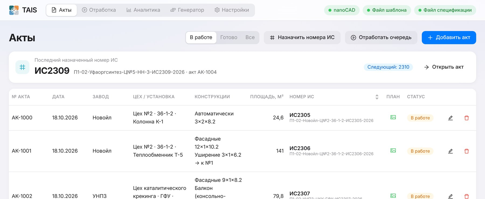

# TAIS — исполнительные схемы строительных лесов

Программа для Windows: по акту строит исполнительную схему строительных лесов «Союз» в **nanoCAD** —
вставляет конструкцию в шаблон, заполняет основную надпись, спецификацию с весами, таблицу габаритов
и ситуационный план, сохраняет DWG и печатает (или сохраняет в PDF).

Порядок работы: **внести акты → назначить номера ИС → отработать очередь** (по одному акту или
целиком в авто-режиме). Поддерживаются башенные, фасадные и радиальные леса, уширения и балконы.

Есть и мобильная версия для Android: ввод конструкций → спецификация и три вида, без сети.



---

## Установка (для пользователя)

**Что нужно:** Windows 10 или 11 (64-бит) и **nanoCAD** — для построения чертежей. Без nanoCAD
программа тоже работает: акты вносятся, расчёт и спецификация считаются, но чертёж не строится.

1. Откройте страницу **[Releases](../../releases/latest)** и скачайте `TAIS-Setup-<версия>.exe`.
2. Запустите установщик, выберите папку (можно оставить предложенную) → «Установить».
3. На рабочем столе появится ярлык **TAIS**.

Python, Node.js и прочее ставить не нужно — всё уже внутри установщика. Шаблон чертежа
(`Шаблон.dwg`) и спецификация (`Веса элементов.csv`) встроены, схемы сохраняются в `Документы\TAIS`.

> **«Система Windows защитила ваш компьютер»** — нажмите «Подробнее» → «Выполнить в любом случае».
> Установщик не подписан цифровой подписью, поэтому Windows его не узнаёт.

**Обновление** — скачайте новый установщик и поставьте поверх: акты и настройки сохранятся
(они лежат отдельно, в `%APPDATA%\TAIS`). **Удаление** — «Параметры Windows → Приложения → TAIS».

**Android:** на той же странице Releases — `TAIS-mobile.apk`. Скопируйте на телефон и установите
(разрешите установку из неизвестных источников).

📖 Подробная инструкция: [Инструкция пользователя.md](Инструкция%20пользователя.md)
(или PDF: [docs/TAIS — инструкция пользователя.pdf](docs/TAIS%20—%20инструкция%20пользователя.pdf)).

### Где хранятся данные

| Что | Где |
|---|---|
| Готовые схемы DWG и PDF | `Документы\TAIS` (меняется в настройках) |
| Акты, планы, настройки, журнал | `%APPDATA%\TAIS` (`tais.db`, `pictures\`, `settings.json`, `logs\`) |

Резервная копия — скопировать папку `%APPDATA%\TAIS` целиком.

---

## Сборка из исходников

Нужны: **Windows 10/11**, [Git](https://git-scm.com/download/win),
[Python 3.10+](https://www.python.org/downloads/) (при установке отметить «Add python.exe to PATH»),
[Node.js 22 LTS](https://nodejs.org/).

```powershell
git clone https://github.com/taglatipov-dotcom/TAIS.git
cd TAIS
python -m venv .venv
powershell -ExecutionPolicy Bypass -File build.ps1
```

`build.ps1` сам поставит зависимости, соберёт интерфейс, прогонит тесты, упакует сервер
(PyInstaller) и установщик (electron-builder). Результат — `Desktop\dist\TAIS Setup <версия>.exe`.

Демо-версия с ограничением по дате: `build.ps1 -DemoUntil 2026-12-31`.

APK для Android — `Mobile\build-android.ps1` (нужен Android Studio и JDK 21),
подробности — [Mobile/README.md](Mobile/README.md).

Запуск в режиме разработки, тесты и устройство проекта —
[docs/Разработка.md](docs/Разработка.md). Правила, по которым генератор раскладывает элементы, —
[docs/Правила сборки лесов.md](docs/Правила%20сборки%20лесов.md).

### Автоматическая сборка (GitHub Actions)

- При каждом push запускаются тесты (Python-генератор, сборка интерфейса, сверка JS-генератора мобильной
  версии с Python).
- При публикации тега `v*` собираются установщик и APK и выкладываются в Releases:

  ```powershell
  git tag v0.1.0
  git push origin v0.1.0
  ```

## Стек

Python 3.10, FastAPI + Uvicorn, pywin32 (COM nanoCAD) · React 19, Vite, antd, Tailwind 4 ·
Electron + electron-builder (NSIS), PyInstaller · Android — Capacitor 7.

```
Electron (окно программы)
  └─ запускает tais-backend.exe (FastAPI) на 127.0.0.1:<свободный порт>
       ├─ /api/...  — генератор, акты, настройки, nanoCAD (COM)
       └─ /         — интерфейс (React)
```
